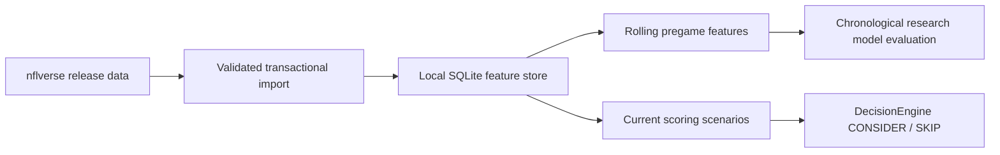

# nflverse integration

ScorPred's primary NFL history/modeling source is nflverse. It uses the maintained
[nflreadpy](https://nflreadpy.nflverse.com/) loader for imports; the former
[`nfl_data_py` project is deprecated](https://github.com/nflverse/nfl_data_py).
No API key is needed. TheSportsDB is not part of this integration.

The expanded dataset catalog, strict availability policy, metric definitions,
versioned migration, refresh commands and current import coverage are documented
in [NFL analytics operations](NFL_ANALYTICS.md). The `analytics` profile extends
this same importer/store; advanced research endpoints are disabled by default.

## Data path



Install/import from the repository root:

```powershell
.\.venv\Scripts\python -m pip install -r requirements-nfl.txt
.\.venv\Scripts\python -m scripts.sync_nflverse --seasons 2022,2023,2024,2025,2026
.\.venv\Scripts\python -m scripts.sync_nflverse --seasons 2026 --datasets player_stats,rosters,depth_charts,pbp
.\.venv\Scripts\python -m scripts.sync_nflverse --profile free --keep-going
.\.venv\Scripts\python nfl_model.py
```

Choose the appropriate seasons when running in a later year. Use
`NFL_DATA_SOURCE=nflverse` (the default), then restart Flask. `espn` explicitly opts
back into the prior schedule provider. If the store is not seeded on a new host,
the app labels and uses the ESPN fallback; imported local data is not committed
to Git or automatically copied during deployment.

`--profile free` imports schedules, teams, team/player stats, rosters, depth charts,
snap counts, all three Next Gen Stats feeds, weekly rosters, the global player
directory and injury research snapshots. No key or paid account is needed. It
excludes the larger play-by-play download, which remains available explicitly.
Without `--seasons`, January/February use the preceding NFL season; other months
use the current year. Use `--seasons 2022,2023,2024,2025,2026 --profile free
--keep-going` for a larger research history, allowing additional download time.
Older source coverage varies; missing assets fail explicitly.

`--keep-going` lets independent feeds finish when another feed fails. Its final
report includes failures and exits **1** for a partial import, so a maintenance
job cannot mistake partial coverage for success. Failed replacements keep the
previous rows, coverage and import timestamp. Default imports fail immediately.
Successful imports now upsert changed/new natural keys and preserve omitted rows
and prior observed versions. Use `--refresh` to skip datasets not yet due.

The store is `cache/nflverse/nflverse.sqlite3` under `SCORPRED_DATA_ROOT`.
It uses SQLite WAL, bounded lock waits and a transaction per dataset/season.
Validation rejects empty replacements, duplicate provider keys and missing
identities; failed imports preserve the previous dataset. Every dataset records
row count, receipt time and a SHA-256 content fingerprint. Loader downloads have
their own local filesystem cache. Flask does not import Polars/nflreadpy or load
full play-by-play files to serve a page.

The NFL coverage panel lists the additional research snapshots, row counts,
latest included week and import times in US Eastern time. Imported context is
flagged for refresh after 48 hours. Receipt time is not the provider's report
time: a freshly downloaded file may still omit recent games or players. The
latest week is the maximum across the file, not a completeness guarantee for
every team. The global player directory is stored once under season `0`.

## What is stored

- Schedules/results retain native game IDs, team abbreviations and separate ESPN
  event references. NFL season years remain distinct from calendar years.
- Weekly team stats retain game/team keys and include EPA/CPOE, scoring-related
  statistics and other source fields.
- Weekly player stats and rosters are contextual datasets, not active model inputs.
- Depth charts retain all timestamped snapshots and historical weekly rows.
  Exact duplicate upstream rows are collapsed by the loader adapter. No player injury
  or starting-lineup inference is made from a depth-chart entry.
- Play-by-play stores a selected schema: game/play IDs, teams, play type, EPA,
  success, yards, pass/rush flags and exclusion flags. It does not claim to retain
  all hundreds of columns from the original nflverse file.

## Additional free data, verified October 18, 2026

| Dataset selection | Useful information | Successfully imported rows |
|---|---|---:|
| `snap_counts` | Player offensive, defensive and special-teams usage | 7,463 |
| `ngs_passing` | Time to throw, air yards, expected completion and CPOE | 200 |
| `ngs_rushing` | Rushing efficiency, stacked boxes, yards over expected | 203 |
| `ngs_receiving` | Separation, cushion, air yards and YAC over expected | 487 |
| `weekly_rosters` | Week-specific team membership and cross-provider IDs | 15,327 |
| `players` | Global GSIS/ESPN/PFR identifiers and player directory | 24,854 |
| `injuries` | Historical practice/report status snapshots | 1,789 |

All season-specific files above reached week 6 for the 2026 season when checked;
the directory covers multiple seasons. These are local import observations, not
promises of ongoing upstream availability. In total, these seven added datasets
contributed **50,323 records**. No paid API subscription was activated.

[Next Gen Stats](https://nflreadr.nflverse.com/reference/load_nextgen_stats.html)
only includes players meeting upstream attempt thresholds. `week == 0` rows are
season aggregates, not another game; they are retained for research and must not
be mixed into rolling weekly features. Missing roster GSIS IDs remain missing;
unlinked entries are retained without inventing cross-provider identities.
[Snap counts](https://nflreadr.nflverse.com/reference/load_snap_counts.html) retain
their original PFR player identifiers alongside game/team identity.

The injury file was available during this check, but its imported schema does
**not** include report-issued timestamps. It is exposed as an injury research
snapshot. The separate **Pregame injuries** connection remains unconnected:
snapshot rows do not establish current availability or confirmed inactives. No
injury, NGS, snap, roster or directory field is added to active model features by
this import. New features require a versioned schema and chronological evaluation.

Credit: data distributed by [nflverse](https://github.com/nflverse/nflverse-data),
Next Gen Stats from NFL NGS, snap counts from Pro Football Reference. Preserve
upstream attribution and applicable dataset terms when exporting or redistributing;
the nflverse data repository publishes its
[CC BY 4.0 license](https://github.com/nflverse/nflverse-data/blob/main/LICENSE.md).

The [upstream availability schedule](https://nflreadr.nflverse.com/articles/nflverse_data_schedule.html)
describes different update frequencies for each dataset. Schedule refresh is
lightweight and happens on demand after five minutes. During refresh failures,
snapshots up to 24 hours old are explicitly labeled; older data falls back to ESPN.

Run heavier imports as a separate maintenance job on the host holding the
persistent store. For example, refresh current-season schedules/team stats and
contextual datasets nightly after game days; refresh again after midweek stat
corrections. `sync_nflverse` imports explicitly selected seasons/datasets. It is
not a live streaming or injury service. Allow time/memory for play-by-play files;
these jobs do not run inside web requests. No external cron job was deployed.

## Features and research model

The initial 19-feature schema uses each team's last eight completed games in the
same NFL season (minimum three), with a conservative 24-hour availability lag.
It includes points scored/conceded, win rate, approximate offensive EPA per play,
opponent EPA per play, passing CPOE, giveaways, sample counts, neutral venue,
postseason flag and rest difference. EPA/play is derived from weekly team EPA
and play-count fields; it is not presented as an official nflfastR rate statistic.

Only prior completed games observed before a target's cutoff can contribute its features. Future
scores, current-game stats, closing market odds, recorded game-day weather,
quarterback identities, injuries and depth charts are excluded from the original
19-feature schema. Historical files first imported today cannot establish past
availability: the builder now excludes them from earlier targets. Existing model
artifacts and validation reports were not retrained or republished by this expansion.

`nfl_model.py` fits an imputer/scaler/logistic classifier on the earliest 60% of
completed feature rows, calibrates on the next 20%, then evaluates the final 20%.
Dates stay together across split boundaries. A Ridge model projects team points.
Both are compared with simple training-derived baselines; preprocessing is fitted
only on training rows. The report records window dates, feature/schema/data
fingerprints, missingness, accuracy, log loss, Brier score, ECE and point error.

Research outputs:

- `cache/nflverse/research_model.joblib`: local artifact, explicitly research-only.
- `cache/nflverse/pregame_features.csv`: the feature/target export.
- `data/validation/nflverse_model.json`: reviewable evaluation and limitations.

The research artifact does **not** activate itself or replace dashboard decisions.
Current dashboard estimates remain experimental recent-scoring scenarios, now
using the primary nflverse history. No BET, live accuracy or profitability claim
is added. A production model change needs separate schema compatibility checks,
prospective validation and explicit documented publishing criteria.

The separate [scoring-model workflow](SCORING_MODELS.md) now fits a portable JSON
Ridge point forecast for the analysis panel using these same pregame features.
It includes its own calibration/test report and prediction ranges. It does not
load or activate the research classifier above, or change dashboard decisions.
