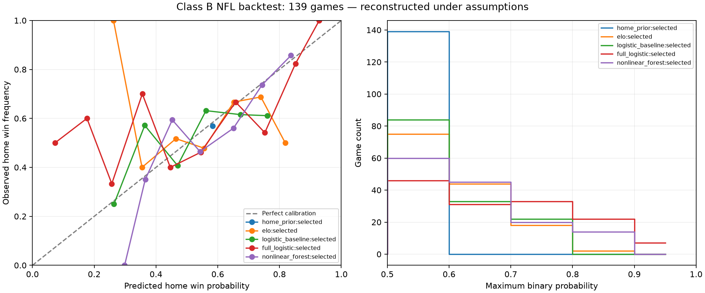

# NFL Phase 2.1 historical recovery

**Historical report:** the latest [Phase 2.2 reliability study](NFL_PHASE2_2_RELIABILITY.md)
evaluates 385 games from this exact frozen dataset and seals 109 future games.
Its guarded, current-code local collector supersedes this report's earlier
manual application-reload recommendation. The original audit, results and
observation timestamps below are retained as dated evidence.

## Original audit failure analysis (before eligibility changes)

The inspected store contains 1,515,697 current records. The original registry
contains zero fitted models. The Phase 2 implementation has 100 predictor names;
its recorded Phase 2 validation result was 651 passing backend tests. All schedule/PBP partitions for 2022–2026 matched their
recorded observation versions.

The saved strict audit `run_3ce4a13d863e716a710c0d5a` reports:

| Season | Total | Eligible | Target schedule not observed | Ties | Not confirmed complete |
|---|---:|---:|---:|---:|---:|
| 2022 | 284 | 0 | 282 | 2 | 0 |
| 2023 | 285 | 0 | 285 | 0 | 0 |
| 2024 | 285 | 0 | 285 | 0 | 0 |
| 2025 | 285 | 0 | 284 | 1 | 0 |
| 2026 | 272 | 0 | 79 | 1 | 192 |

These are first-failure counts. The first guard masks later missing PBP-vintage
and minimum-history checks. Historical schedules were first observed locally
in October 2026. The target schedule guard correctly rejects them before
loading PBP. PBP was also imported retrospectively. Neither its season nor the
prior game's event time establishes when its particular stored values were
available. Source publication timestamps are unavailable. Source ingestion and
first observation coincide in this schema; neither is an event timestamp.
Labels are already separate from predictor dictionaries, and current target
scores do not enter rolling features. Full-season aggregates, rosters, injuries,
weather and betting lines are already excluded. No label-as-feature bug explains
the zero count, and no observation timestamp should be changed to fix it.

Recoverable assumptions must be explicit: finalized earlier event counts and
scores may support a **Class B reconstructed** analysis after a conservative
completion bound and correction/publication delay. This cannot establish
Class A availability. EPA and EPA-based success are model-derived outputs whose
historical model/version is not verified; they need additional evidence, not
just a later assumed publication date. Known retrospective revisions also need
to be detected and excluded rather than silently substituting current values.

The nflverse [publication schedule](https://nflreadr.nflverse.com/articles/nflverse_data_schedule.html)
describes nightly PBP/stat updates and recommends Thursday data after weekly
corrections. This supports a conservative delay assumption, but does not prove
an individual archive's historical values. The nflfastR
[changelog](https://nflfastr.com/news/) documents EP model rebuilds and EPA fixes;
it does not establish a historically valid model version for our imported rows.

## Prospective writer inspection

The local app is a user-owned `python -u app.py` process listening on
127.0.0.1:5001 (venv launcher PID 14732, Python child PID 25016 at inspection).
It started October 18 at 18:59 local time. Schedule refresh is request-driven
inside `services.nflverse_provider.refresh_schedules`; the app scheduler does
not register a separate NFL writer. No matching Windows scheduled task or
Windows service was found. The launcher parent is no longer present.
The venv launcher/child pair is one app, not evidence of two NFL collectors.
No standalone NFL collection process has been identified. Restarting this pair
would restart the entire multi-sport app, so it is outside a narrowly scoped
NFL-writer restart. No process has been terminated or restarted.

## Two evidence classes and reconstruction policy

Class A requires an actual observed source version before cutoff. That guard
is unchanged. The new Class A rejection audit records each game's cutoff,
first schedule observation, unknown publication time and which first failure
masks later checks. The final audit is `run_6b671eefd3f7fb43905bb91b` in
`cache/nflverse/phase2_1/class_a`. It has zero eligible games: 1,216 fail the
schedule guard, four are ties and 191 are not confirmed complete. The one-game
change from the original audit is the passage of the completion confirmation
window, not a relaxed cutoff.

Class B is **historically reconstructed under assumptions**, never relabeled
as observed. It has its own feature version, schema, dataset/registry namespace,
prediction field and report label. Evaluation rejects mixed evidence classes.
The prospective artifact loader rejects Class B, even when a caller knows its
model ID. All artifacts retain `research_only=true`, `enabled=false` and
`production_active=false`.

Default policy:

1. Require a completed, non-cancelled supported NFL event with known kickoff
   and final score. Ties are excluded from binary labels; probabilities condition
   on no tie. Ties can contribute historical half-point context in Elo/form.
2. Use a reliable source `game_end_timestamp` when present. These imported
   schedules have no such verified finish timestamps. Otherwise use **kickoff
   +12 hours as an assumed completion bound**, explicitly retaining actual finish
   as null. A bound is not a measured duration or a guarantee against an
   undetected multi-day suspension. Detected suspended/postponed events fail.
3. Wait **168 further hours** for publication/corrections. Only use a source
   when the resulting assumed availability is strictly before cutoff. Known
   later publication timestamps extend availability; malformed ones fail.
   Same-day events cannot enter. Configuration requires at least 12 completion
   bound hours and 96 publication hours; the measured run uses 12/168.
4. Assume archived event-count fields stabilized after that delay. Reject games
   with detected changes to whitelisted raw event fields, result/schedule
   identity/venue changes, or plays added in later observation batches.
   Unobserved archival revisions cannot be detected; this is a material Class B
   limitation and no claim of point-in-time proof is made.
5. Reuse Phase 2 metric assembly for qualifying earlier games. Keep a minimum
   three same-season measured PBP games for both teams, rolling 3/5/8/season
   windows, explicit missingness and no prior-season team-stat carryover.
   Elo uses the same guarded earlier scores and its existing .75 seasonal
   regression, initial 1500, K=20 and 55 home points. No future season enters.
6. Preserve actual source receipts separately from assumed availability. Class B
   label availability uses the same explicit bound/delay for chronological
   fitting. A retrospective label receipt remains recorded, even when later
   than its assumed historical availability.

The 168-hour delay is deliberately longer than a normal weekly correction
cycle. The nflverse publication schedule supports allowing for corrections,
but **does not verify that our later archive equals its historical version**.
Final schedule identities and neutral/home venue also require a Class B
assumption that they were known pregame; detected revisions are excluded.

## Supported and excluded features

Of the original 100 predictor names, **46** have supported Class B definitions:
rolling yards/play, explosive rate, third-down conversion, red-zone touchdown
efficiency, turnovers, sacks generated/allowed, recent form, schedule strength,
home venue and qualifying rest context. Rates reuse observed numerators and
denominators. No full-season aggregate is used.

The following **54 names remain missing**, rather than importing retrospectively
revised model outputs or uncertain identities: offensive/defensive/passing/rushing
EPA, EPA-based success, opponent-adjusted EPA, and all QB metrics/experience.
There is no verified historical EP model version for these imported values.
QB statistics could be a future independently validated reconstruction, but no
future starter announcement, roster or depth chart is inferred here.
Injuries, betting lines, weather and future player/season summaries are excluded.

Rest/short-week/bye inputs also remain missing if a more recent played game
intervened after the latest publication-eligible statistics game. Otherwise a
lagged window could falsely imply that a team physically rested for two weeks.
Consequently, 107 eligible rows have 46 measured predictors and 781 have 43;
every eligible row is explicitly incomplete against the full 100-name schema.
Training-only preprocessing handles remaining missingness. The small logistic
baseline therefore uses venue, recent form and available rest; its EPA inputs
are excluded, not secretly reconstructed.

## Measured eligibility and manifest

| Season | Schedule games | Class A | Class B | Rejected in B | B eligible but incomplete | Publication/revision exclusions |
|---|---:|---:|---:|---:|---:|---:|
| 2022 | 284 | 0 | 220 | 64 | 220 | 15 |
| 2023 | 285 | 0 | 222 | 63 | 222 | 15 |
| 2024 | 285 | 0 | 223 | 62 | 223 | 14 |
| 2025 | 285 | 0 | 223 | 62 | 223 | 13 |
| 2026 | 272 | 0 | 0 | 272 | 0 | 79 |
| Total | 1,411 | 0 | 888 | 523 | 888 | 136 |

Publication/revision exclusions are a subset of rejected games: 57 have enough
history under the shorter event-only check but fail the added publication delay;
79 current-season games have detected raw PBP revisions. There are also 192
minimum-history exclusions, four ties and 191 unconfirmed outcomes. These are
mutually exclusive first-failure reasons; unsupported feature exclusions do not
appear as additional game rejections. All 2026 games remain outside fitting.
An eligibility increase is not proof that all leakage or revision risk is gone.

The immutable Class B run is `run_d51f0ec86b0dde870b81a606`. Its fingerprint is
`55774852dd69eb7d3c0945795febce780dfeec8b6c7588d6fe458214304d5f86`.
Under `cache/nflverse/phase2_1/class_b/<run_id>/`:

- `dataset.json` separates features and labels and records source fingerprints.
- `availability_manifest.json` contains one record per scheduled game, including
  cutoff, evidence class, eligible/missing counts, dependency IDs, assumptions,
  policy/version/fingerprint and explicit rejection reasons. Its shared source
  catalog contains assumed bounds and actual schedule/PBP observation receipts.
- `evaluation.json` contains every model/calibration/ablation, season/week,
  bucket and paired comparison. `backtest_predictions.json` preserves actual
  batch-generation times and fitting/calibration metadata, separately from live
  research output. Eighteen portable fold artifacts remain disabled.

For example, `2022_04_LA_SF` has kickoff `2022-10-04T00:15Z` and cutoff
`2022-10-03T23:15Z`. Its six team-history dependencies are the two teams' first
three games. `2022_01_BUF_LA` has an assumed completion bound of
`2022-09-09T12:20Z` and assumed availability `2022-09-16T12:20Z`; its **actual**
schedule/PBP observations remain October 16/18, 2026. The manifest never calls
those September bounds observed timestamps.

## Measured chronological backtest

Unchanged defaults use 20 initial training groups, eight tuning groups, eight
calibration groups split into fitting/selection halves, and eight test groups.
Whole season/weeks stay together; label availability can purge whole groups at
boundaries. Models freeze within each test block. Elo updates online only when
its earlier result passes the same availability policy. Fixed seed is 1729.
Two folds qualify; three others fail unchanged sample thresholds.

| Fold | Train | Tune | Calibration fit | Calibration select | Test | Test cutoff span |
|---|---:|---:|---:|---:|---:|---|
| 0 | 220 | 100 | 44 | 38 | 79 | 2024-01-28 through 2024-11-05 |
| 1 | 435 | 64 | 41 | 45 | 60 | 2025-01-04 through 2025-10-13 |

Spans include an offseason because groups are eligible season/weeks, not
calendar weeks. Of 888 eligible examples, 139 receive out-of-sample predictions;
749 are warmup, development/calibration or skipped test groups. Test coverage
is 3 games from season 2023, 105 from 2024 and 31 from 2025. The three-game
2023 subset is not a credible standalone performance estimate.

| Model, prior-data selected calibration | Games | Log loss | Brier | Accuracy | ROC-AUC | ECE |
|---|---:|---:|---:|---:|---:|---:|
| Home prior | 139 | 0.684146 | 0.245510 | 56.83% | 0.513186 | 0.014375 |
| Elo | 139 | 0.685779 | 0.245627 | 55.40% | 0.584599 | 0.063585 |
| Small logistic | 139 | 0.678255 | 0.242256 | 61.15% | 0.586076 | 0.081834 |
| Expanded logistic | 139 | 0.708323 | 0.250808 | 58.27% | 0.612869 | 0.122180 |
| Random forest | 139 | 0.649553 | 0.230126 | 57.55% | 0.640928 | 0.071863 |

The forest's point estimates improve primary metrics, while small logistic has
higher accuracy. Neither observation establishes superiority. With 500 paired
season/week block-bootstrap replicates over 16 blocks, forest-minus-prior 95%
intervals are **[-0.089456, +0.031166]** for log loss and
**[-0.042198, +0.014299]** for Brier. Versus Elo they are
**[-0.066317, +0.000972]** and **[-0.030370, +0.002214]**. All include zero.
These exploratory intervals do not resolve reconstruction uncertainty or
multiple-comparison risk. **Meaningful improvement is not established.**

Expanded logistic is worse than small logistic on pooled primary metrics.
Group-only basic-strength/recent/rest-home log losses are 0.673281, 0.656501
and 1.248841, with Brier 0.238039, 0.231312 and 0.266327. Full-minus-rest/home
is 0.685156/0.240500. EPA/QB-only ablations are unavailable. Removing those
already-excluded groups yields identical full-model results, which is not
evidence that EPA/QB have no value. No best-looking test ablation is promoted.

## Calibration and figures

Both folds retained **raw** probabilities for all three main classifiers based
only on earlier selection games. Isotonic was not fitted: 44/41 calibration-fit
rows fall far below the predeclared 1,000 minimum. Separate fit/selection halves
avoid reusing the final test outcomes, but these small samples leave calibration
generalization inconclusive.

| Classifier | Raw log loss / Brier / ECE | Sigmoid log loss / Brier / ECE |
|---|---|---|
| Small logistic | 0.678255 / 0.242256 / 0.081834 | 0.696123 / 0.251506 / 0.071976 |
| Expanded logistic | 0.708323 / 0.250808 / 0.122180 | 0.680095 / 0.243808 / 0.072079 |
| Forest | 0.649553 / 0.230126 / 0.071863 | 0.663427 / 0.236157 / 0.051454 |

Sigmoid helps expanded logistic on the final test retrospectively, but earlier
selection did not justify it. The report keeps that honest result rather than
choosing a calibrator after seeing test outcomes. A rest/home-only ablation's
selected sigmoid also fails badly on test log loss; that adverse result is
retained. ECE on sparse buckets and concentrated home-prior probabilities is
not proof of reliable calibration.



[Export reliability SVG](assets/nfl_phase2_1/reliability_and_confidence.svg),
[raw/sigmoid/selected comparison SVG](assets/nfl_phase2_1/calibration_raw_vs_selected.svg),
[comparison PNG](assets/nfl_phase2_1/calibration_raw_vs_selected.png), and
[all probability buckets CSV](assets/nfl_phase2_1/probability_buckets.csv).
Figures use actual predictions and matplotlib 3.11.2, installed locally as an
optional research plotting dependency. Production dependency files were not
changed; model training still uses existing scikit-learn.

## Prospective collection verification and operator reload

Migration **3** adds append-only `collection_receipts` and `collection_games`;
it does not rewrite existing source rows. Triggers protect observations and
receipts from update/delete. Receipts record source/data type, UTC attempt and
actual receipt/ingestion times, nullable verified publication time, content hash,
writer version, row count, game associations, status/error and freshness.
HTTP Last-Modified/ETag are preserved as transport metadata, not represented as
verified historical publication dates. Unchanged pulls retain the old first
observation while recording a new collection receipt. Failures retain the last
successful payload and receipt age.

A real existing-provider schedule refresh succeeded at
**2026-10-19T14:10:44.074779Z**, using writer `nflverse-collection-v3`:
272 rows/game associations, content SHA-256
`a01db46dcbcda2ff45a5103003a4f837a7bb86ddaa0ddc990dcdc7ec4e22db8c`.
All current schedule rows matched recorded versions afterward. The 1,530,347
pre-existing observation records have the same before/after streamed SHA-256
`a83d4d8dd0b5310dc88548c31c96e06393adc8f01b8fd9bcf4c353a675cdc94f`.
Current source-record count remains **1,515,697**. Evidence is saved in
`cache/nflverse/phase2_1/collection_verification.json` and
`history_before_collection.json`.

**No running process was restarted.** The identified writer is embedded in the
whole app; there is no verified NFL-only manager to restart without interrupting
other sports. This successful one-shot collection proves the current code path,
not that the old app has reloaded it. Later legacy writes may still be blocked
by the existing integrity guard.

For an operator-planned reload, first ensure active jobs have finished and retain
the original launcher environment (including data root and secrets). Recheck the
listener and command line rather than relying on old PIDs:

```powershell
Get-NetTCPConnection -LocalAddress 127.0.0.1 -LocalPort 5001 -State Listen |
  Select-Object OwningProcess
Get-CimInstance Win32_Process -Filter "ProcessId=25016" |
  Select-Object ProcessId,ParentProcessId,ExecutablePath,CommandLine
```

Use Ctrl+C in the **identified app's original console** for a graceful stop.
There is no verified task/service name for an NFL-only restart. If its console
or original environment cannot be recovered, have the operator recover that
launcher before stopping anything. From the same preserved environment:

```powershell
Set-Location C:\Users\User\Documents\scorpred
$env:PORT = "5001"
.\.venv\Scripts\python -u app.py
```

Confirm exactly one app listener and one successful current-writer receipt.
The launcher/child process pair is normal. Do not start a second app alongside
the old listener. To verify collection without restarting or starting an app:

```powershell
.\.venv\Scripts\python -c "from services.nflverse_provider import refresh_schedules; refresh_schedules([2026])"
.\.venv\Scripts\python -m scripts.sync_nflverse --status
```

For future PBP receipts, continue the existing offline importer, rather than
adding another ingestion system:

```powershell
.\.venv\Scripts\python -m scripts.sync_nflverse --seasons 2026 --datasets schedules,pbp --refresh --keep-going
.\.venv\Scripts\python -m scripts.nfl_winner_research --seasons 2026 --snapshots-only
```

No new persistent collector, Windows task or service was started in this task.

## Leakage validation and reproducibility

Twelve new offline tests exercise retrospective receipts without backdating,
known revisions and late-added plays, future EPA/QB/injury/season data,
same-day ambiguous completion, explicit publication changes, target labels,
future-season Elo, venue revisions, mixed-class rejection, Class B live-artifact
rejection, immutable history/receipts, actual network receipt time and
fingerprint-checked frozen replay. Existing tests retain train-only preprocessing,
purged whole-week folds, disjoint calibration and independent sklearn/portable
JSON agreement. They do not need live internet access.

The actual frozen dataset fingerprint was independently checked. All **1,251
selected artifact/game probabilities** across 18 fold artifacts replay exactly
(maximum absolute difference **0.0**). All 888 eligible rows' dependency lists
were checked for target exclusion and strict assumed availability before cutoff.
No violating dependency was found. This verifies the stated assumptions in
software; it does not verify unknown historical publication/revision history.
Evidence is `replay_verification.json` alongside the saved run.

Final validation: **663 backend tests passed in 100.01 seconds**, including
the existing NFL, NBA, soccer, migration and no-fallback regressions. The 12 new
recovery/collection/replay tests passed offline. The frontend TypeScript/Vite
production build passed with 1,743 modules. Ruff on all changed Python files and
`git diff --check` passed. Charts were generated from the recorded predictions
and visually inspected. No backend or frontend service was deployed.

```powershell
# Strict observed audit: exits 2 because there is still insufficient Class A history.
.\.venv\Scripts\python -m scripts.nfl_winner_research --seasons 2022,2023,2024,2025,2026 --evidence-class A --output cache/nflverse/phase2_1/class_a
# Separate reconstructed training/evaluation; never enables a model.
.\.venv\Scripts\python -m scripts.nfl_winner_research --seasons 2022,2023,2024,2025,2026 --evidence-class B --publication-lag-hours 168 --completion-bound-hours 12 --output cache/nflverse/phase2_1/class_b
# Refit against the exact saved dataset, independent of later source refreshes.
.\.venv\Scripts\python -m scripts.nfl_winner_research --evidence-class B --replay-dataset cache/nflverse/phase2_1/class_b/run_d51f0ec86b0dde870b81a606/dataset.json --output cache/nflverse/phase2_1/replay
# Optional figures on another machine; no production requirement.
.\.venv\Scripts\python -m pip install matplotlib==3.11.2
.\.venv\Scripts\python -m pytest tests -q
```

New observations legitimately change a rebuilt dataset's fingerprint; frozen
replay preserves the evaluated source snapshot. Actual generation timestamps
change on refitting, while deterministic parameters/probabilities reproduce.
Preserve the local cache run directory; it is not a production model manifest.

## Changed files and remaining limitations

New source files: `services/nfl_historical_recovery.py`,
`tests/test_nfl_historical_recovery.py`, migration
`migrations/nflverse/003_collection_receipts.sql`, this report and the five
exported chart/CSV files under `docs/assets/nfl_phase2_1/`.
Updated: `services/nfl_winner_features.py`, `services/nfl_winner_evaluation.py`,
`services/nfl_winner_research.py`, `services/nflverse_store.py`,
`services/nflverse_provider.py`, `scripts/nfl_winner_research.py`,
`scripts/sync_nflverse.py`, `nfl_routes.py`, and both Phase 2 reports.

Unknown historical revisions, assumed schedule/completion/publication timing,
excluded EPA/QB inputs, incomplete features, two folds/139 tests, sparse
calibration and the unreloaded old app limit the result. No candidate has earned
production use. Keep the small model as the predeclared research starting point,
collect Class A observations and test prospectively before reconsidering model
complexity or activation.

Production NFL predictions/dashboard decisions, NBA and soccer logic, production
model selection and activation flags were not changed. No paid dependency or
subscription was introduced. **No deployment or model activation occurred.**
