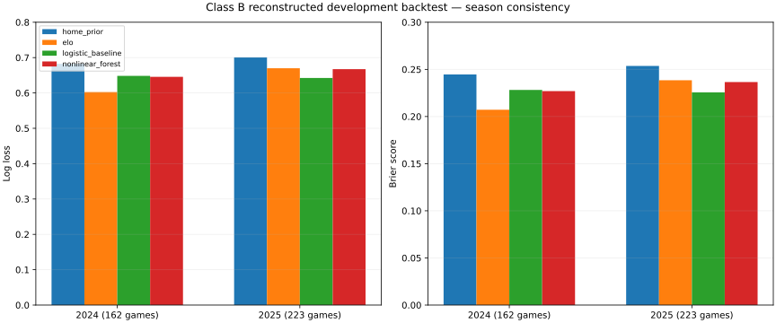
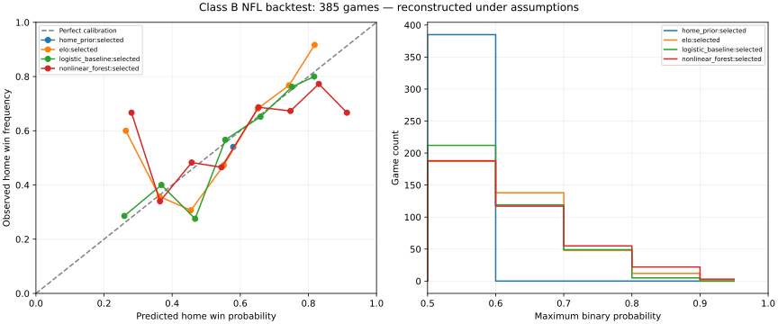
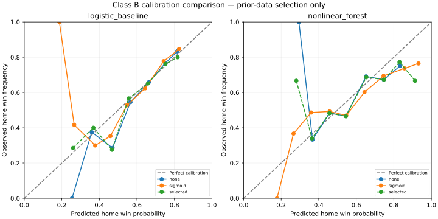

# NFL Phase 2.2: prediction reliability and prospective collection

The expanded chronological development backtest evaluates **385 identical games
across ten folds**, up from 139 in Phase 2.1. Small logistic improves on the home
prior, but **neither candidate establishes consistent improvement over Elo**.
All research models remain disabled. No production prediction code, production
model selection, or deployment was changed in this phase.

The backtest was completed October 19, 2026. Operational checks were continued
October 20. Receipt times below are actual UTC times, not simulated historical
availability. These results use free nflverse data and the existing model families.

## Evaluation population and leakage safeguards

The exact Phase 2.1 dataset was replayed, rather than reconstructing a more
favorable dataset using later source revisions. Its 888 games are **Class B**:
historically reconstructed under explicit assumptions, not proven historical
point-in-time observations. The fingerprint is
`55774852dd69eb7d3c0945795febce780dfeec8b6c7588d6fe458214304d5f86`.

The existing reconstruction rules remain: a kickoff-plus-12-hour completion
bound followed by a 168-hour publication/correction delay, no same-day inputs,
known source revisions excluded, and separate outcome labels. Unverified
historical EPA, model-derived success and quarterback information remain masked.
At most 46 of the existing 100 predictors have reconstruction support; 781 rows
have 43 present values and 107 have 46. The small logistic consequently uses its
three supported existing inputs: home field, prior win-rate difference and rest
difference. Its two EPA inputs are unavailable. No predictors were added.

Phase 2.1's fixed eight-group tuning/calibration/test layout produced only two
accepted folds. Sparse postseason groups and purging unavailable labels left
three other proposed folds below sample thresholds. Advancing eight groups even
after a failed proposal also skipped potential test starts. Dataset eligibility
alone does not make a game independently testable: earlier fitting, tuning and
calibration examples must all exist first.

The new split strategy builds development windows backward from each proposed
test start. It extends sparse windows farther into the past and advances one
whole week after a failed proposal. Boundaries use counts and prior label
availability, never test scores. The minimum requirements are:

| Window | Games | Effective season/week groups |
|---|---:|---:|
| Training | 200 | 20 |
| Tuning | 50 | 8 |
| Calibration fitting | 40 | 4 |
| Calibration selection | 40 | 4 |
| Test | 30 | Whole groups; final small tail appended |

All development stages require both outcome classes. A whole earlier group is
purged if any label is unavailable before the next stage's earliest prediction
cutoff. Preprocessing is fitted on training data; hyperparameters and calibration
are chosen on separate earlier windows. No week is split. These rules strengthen
the former calibration-half floor of ten; they do not relax leakage controls.

| Season | Eligible reconstructed games | Phase 2.2 test games | Warmup/development only |
|---|---:|---:|---:|
| 2022 | 220 | 0 | 220 |
| 2023 | 222 | 0 | 222 |
| 2024 | 223 | 162 | 61 |
| 2025 | 223 | 223 | 0 |
| Total | 888 | **385** | **503** |

Test cutoffs span October 31, 2024 through February 8, 2026. Fold sizes are
43, 42, 32, 32, 44, 42, 43, 30, 32 and 45. There are 310 newly evaluated games
and 75 overlapping the earlier evaluation; 64 earlier games are not repeated
under the stricter windows and changed refitting schedule. Their saved results
remain intact. Do not pool the two reports into a single performance estimate or
interpret the omitted 64 games as proven unsafe.

## Measured performance

These are the selected-calibration predictions on the same 385 games. Log loss,
Brier and ten-bin expected calibration error (ECE) are lower when better.
Accuracy and ROC AUC are higher when better. Binary probabilities condition on
no tie; ties are excluded explicitly.

| Model | Log loss | Brier | Winner accuracy | ECE | ROC AUC |
|---|---:|---:|---:|---:|---:|
| Home prior | 0.692911 | 0.249856 | 54.03% | 0.039145 | 0.504672 |
| Sequential Elo | **0.641521** | **0.225308** | 63.38% | 0.071037 | **0.694616** |
| Small logistic | 0.644881 | 0.226703 | **64.42%** | 0.044323 | 0.681361 |
| Random forest | 0.658181 | 0.232520 | 58.70% | 0.053789 | 0.649636 |

Elo has the best pooled probability scores. Logistic's four additional correct
winners compared with Elo do not establish better probability estimates.
The home prior's low ECE also illustrates why calibration alone cannot establish
useful discrimination.

| Season / games | Model | Log loss | Brier | Accuracy | ECE |
|---|---|---:|---:|---:|---:|
| 2024 / 162 | Home prior | 0.682360 | 0.244623 | 57.41% | 0.009973 |
| 2024 / 162 | Elo | **0.602472** | **0.207186** | **66.67%** | 0.113451 |
| 2024 / 162 | Small logistic | 0.648337 | 0.228199 | 63.58% | 0.059261 |
| 2024 / 162 | Forest | 0.645617 | 0.226960 | 56.79% | 0.096196 |
| 2025 / 223 | Home prior | 0.700577 | 0.253657 | 51.57% | 0.060338 |
| 2025 / 223 | Elo | 0.669888 | 0.238474 | 60.99% | 0.070658 |
| 2025 / 223 | Small logistic | **0.642370** | **0.225617** | **65.02%** | 0.062869 |
| 2025 / 223 | Forest | 0.667308 | 0.236559 | 60.09% | 0.051853 |

Both candidates lose to Elo on probability scores in 2024 and improve in 2025.
Only two seasons contribute test games; 2024 coverage starts late in the season.
Neither candidate meets the registered consistency criterion.



## Paired uncertainty and calibration

Intervals resample **33 paired season/week blocks**, keeping every model's
prediction and outcome paired, using 5,000 bootstrap draws. Negative deltas
favor the candidate. The eight primary comparisons comprise two candidates,
two references and two probability metrics. In addition to ordinary 95%
intervals, 99.375% marginal intervals provide Bonferroni adjustment for that
predeclared family of eight. These approximate bootstrap intervals do not remove
historical reconstruction uncertainty, dependence across weeks, or prior research
selection effects.

| Candidate minus reference | Metric | 95% interval | Family-adjusted interval |
|---|---|---|---|
| Logistic minus home prior | Log loss | [-0.068860, -0.026255] | [-0.076623, -0.016173] |
| Logistic minus home prior | Brier | [-0.033227, -0.012504] | [-0.036821, -0.007670] |
| Forest minus home prior | Log loss | [-0.062394, -0.006435] | [-0.072828, +0.002224] |
| Forest minus home prior | Brier | [-0.029737, -0.004877] | [-0.034562, -0.000754] |
| Logistic minus Elo | Log loss | [-0.024847, +0.032626] | [-0.036231, +0.042744] |
| Logistic minus Elo | Brier | [-0.012022, +0.015206] | [-0.017370, +0.019678] |
| Forest minus Elo | Log loss | [-0.012133, +0.044741] | [-0.024476, +0.055949] |
| Forest minus Elo | Brier | [-0.006326, +0.020467] | [-0.011858, +0.025387] |

Logistic's advantage over the home prior survives the family adjustment under
the Class B assumptions. Forest's log-loss advantage over that prior does not.
Every comparison against Elo includes zero. There is no statistically convincing
evidence that either candidate improves on Elo, and forest complexity is not
justified by these results.

Calibration fitting windows contain 44–61 observations. Sigmoid calibration was
selected using earlier selection data in two logistic folds and one forest fold;
the remaining folds retained raw probabilities. Isotonic was unavailable because
the unchanged fitting floor is 1,000 observations.

| Candidate / calibration | Log loss | Brier | ECE |
|---|---:|---:|---:|
| Logistic raw | 0.643373 | 0.226058 | 0.046414 |
| Logistic sigmoid throughout | 0.654284 | 0.231112 | 0.045592 |
| Logistic selected on prior windows | 0.644881 | 0.226703 | 0.044323 |
| Forest raw | 0.657791 | 0.232661 | 0.054958 |
| Forest sigmoid throughout | 0.676469 | 0.238812 | 0.072951 |
| Forest selected on prior windows | 0.658181 | 0.232520 | 0.053789 |

There is no consistent calibration gain. The primary results retain the actual
prior-window selection; test performance was not used to switch back to raw.





The underlying [probability buckets](assets/nfl_phase2_2/probability_buckets.csv)
and [paired intervals](assets/nfl_phase2_2/paired_intervals.csv) are provided for
inspection. Small bucket counts make the reliability curves noisy.

## Collector handoff and data preservation

Inspection found a legacy request-driven writer inside the running multi-sport
application. Restarting that application would also load unrelated workspace
changes. Instead, collection was handed to a current-code, isolated worker using
the **existing** schedule importer, nflverse importer and Class A snapshot builder.
The application process was left running; its module was not hot-reloaded.

The per-user Windows task **ScorPred NFL Collector** starts a hidden Python
worker at logon. The manager verifies the task owner, executable, arguments and
working directory before changing it. Reload waits for graceful completion and
restart. A lock on the actual database path rejects a second collector even
when another state directory is supplied; a real duplicate attempt was rejected.

Additive migration 4 blocks legacy unversioned writes and deletion of preserved
records before they mutate the database. Current writers append the matching
immutable observation first, then upsert. Migration 3's immutable source history
remains intact. All **1,530,347** observations in the pre-handoff preservation
checkpoint were rehashed unchanged:
`a83d4d8dd0b5310dc88548c31c96e06393adc8f01b8fd9bcf4c353a675cdc94f`.
The October 20 verification counts 1,516,580 current source records. Previously
unlogged intermediate legacy snapshots cannot be recovered.

Schedules refresh every four minutes, PBP every six hours and prospective
feature snapshots every twenty minutes. Snapshots require a genuinely observed
source vintage and at least sixty minutes before kickoff. The October 19
verification checked 28 saved Class A pregame snapshots, including a receipt at
15:17:42.518046 UTC followed by snapshot generation at 15:17:43.797502 UTC.
Timestamp order and cutoff constraints passed. Unchanged pulls preserve each
record's first observation time and still append a receipt; source publication
time remains explicitly unverified. Receipt/heartbeat code hashes identify the
loaded writer, rather than claiming edited files are already loaded.

**Operational check, October 20:** the scheduled task is running, worker PID
4532, with loaded code hash
`16bb0179d44454934bee826983673b86cc9c7d25a3e31e1fa846e2af6d5ad826`.
A local DNS failure was detected and reported as degraded; the failed refresh
preserved prior data and its timestamp. After DNS recovered, the worker was
stopped gracefully and the existing importer retried once under the same
database lock, with its download cache explicitly bypassed. Receipt 42 records
**16,380 PBP rows at 2026-10-20 11:35:08.848004 UTC**. The restarted worker saved
schedule receipt 43 at **11:35:15.401946 UTC**, generated **28 pregame snapshots**,
and completed its cycle successfully with no errors at 11:35:50 UTC. Its current
code hash matches the files on disk. The original application PID 25016 remains
unchanged. Current evidence is saved separately in
`cache/nflverse/phase2_2/operational_verification_2026_10_20.json` so the earlier
October 19 verification remains intact. Collection depends on
the PC being awake, the user being logged in and network access. Missed pregame
cutoffs cannot be filled retrospectively or counted as observed predictions.

The [saved operational verification](assets/nfl_phase2_2/verification.json),
generated at 11:38:22 UTC, independently rechecked all 28 current pregame
snapshots, the unchanged preservation hash, frozen dataset fingerprint, replayed
probabilities, identical test populations and the sealed holdout exclusion.

## Genuinely untouched final holdout and next step

All earlier historical results are development evidence. No previously inspected
historical subset is relabeled as untouched. At **2026-10-19 15:08:29 UTC**, before
inspecting the expanded results, the protocol reserved **109 unplayed 2026
regular-season games in weeks 12–18**. Every selected kickoff was future and both
scores were absent. Their outcomes have not been evaluated, fitted, tuned or
used for calibration in this study.

The immutable protocol is `cache/nflverse/phase2_2/protocol.json`, hash
`a4b906096d31dccbeceabdf4ffa1a275dccdd6a08206b2b636bac8026f202281`.
It stays sealed and requires explicit future review no earlier than
**March 1, 2027 UTC**. The earliest registered kickoff is November 26, 2026 at
01:00 UTC, giving a first sixty-minute deadline of **November 26 at 00:00 UTC**;
actual schedule changes must be respected.

**Exact next step:** before that first cutoff, freeze the study artifacts and
the matching existing feature mapping for logistic, forest, Elo and the home
prior. Implement offline, immutable research forecasts from genuinely observed
Class A sources with the same supported feature mask and conservative source
lag as training; save each forecast at least sixty minutes before kickoff.
Verify this path on non-holdout fixtures and do not inspect holdout outcomes
until the sealed review. Then perform one paired evaluation on the registered
population, reporting missing forecasts rather than filling them after kickoff.

That matched prospective forecasting path has **not yet been implemented**.
The existing inference loader correctly rejects Class B artifacts as live
Class A models. The collector saves observations and feature snapshots; it does
not bypass that rejection or automatically forecast the reserved holdout.
Do not activate a model to bridge this gap.

Production remains blocked by unverified historical source vintages, no
convincing advantage over Elo, inconsistent season results, uncertain calibration,
and the absence of a completed prospective forecast-and-outcome validation.
Even 109 holdout games may leave wide uncertainty intervals.

## Artifacts, reproduction and validation

The final disabled run is
`cache/nflverse/phase2_2/run_30fe98722d5901403574f017`. It contains the frozen
dataset, evaluation, coverage audit, all probabilities, twenty fold artifacts
(two candidates per fold), figures and CSVs. Earlier runs remain preserved.
The registry and every artifact retain `research_only=true`, `enabled=false`
and `production_active=false`.

The existing evaluator defaults to its earlier fixed-group strategy. Only the
separate Phase 2.2 command opts into adaptive windows and the two existing
candidates. Reproduce the development study from the repository root:

```powershell
.venv/Scripts/python.exe -m scripts.nfl_reliability
& scripts/manage_nfl_collector.ps1 -Action Status
& scripts/manage_nfl_collector.ps1 -Action Reload
.venv/Scripts/python.exe -m scripts.sync_nflverse --status
```

The replay verifies its fingerprint and refuses reserved holdout IDs or seasons
after 2025 in fitting data. An existing registered protocol is verified and
preserved, never silently replaced. Manager reload affects only the local
collector; it does not deploy or restart the web application.

Validation completed October 20: **672 backend tests passed in 186.26 seconds**,
including NBA, soccer, NFL, fallback and migration regressions; the frontend TypeScript/Vite build passed
(1,745 modules in the October 20 rebuild). Nine new adversarial tests cover causal split boundaries,
sparse windows, outcome-independent test boundaries, direct recomputation of
paired bootstrap intervals, holdout registration/tamper rejection, legacy writer
blocking, singleton/graceful stop and visible partial collection failures. Ruff
and diff checks passed. Independent scikit-learn scoring matches saved metrics;
770 selected model/game probabilities replay exactly, and all ten folds passed
timing/disjointness checks. The saved October 19 evidence is
`cache/nflverse/phase2_2/verification.json`.
