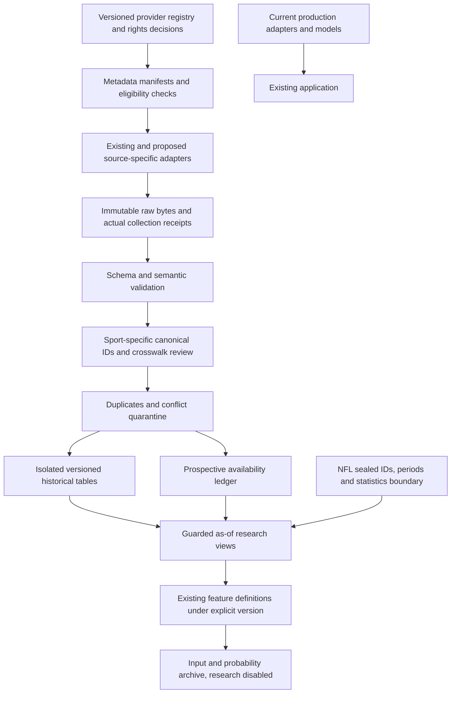

# Proposed multi-source data architecture

Phase 3 proposal only. No registry, adapter, database migration, new collection job or serving change is activated by this document. Preserve the current Flask/React services, existing NFL store, frozen archives and source compatibility checks.

## Extend the architecture around its existing strengths

NFL already has a dataset catalogue, transactional versioned ingestion, natural provider keys, collection receipts/backoff, guarded readers and frozen input/forecast archives. Reuse that pattern. NBA/soccer currently have response caches, CSVs and prediction tracking; add an isolated historical/prospective evidence layer before routing any new provider into production. Do not replace working source adapters with a generic scraper or import an R runtime solely to read Parquet.

The diagram's proposed path has no automatic arrow into production. Promotion would be a separately reviewed release, after coverage, rights and validation gates; deployment is outside this task.

## Provider registry

A future `config/data_providers.yaml` can declare provider, source family, sport, competition scope, dataset, parser/schema version, original URL, pinned commit/release/asset, code licence, data licence, attribution text, source-rights evidence, allowed use, redistribution/adaptation rules, review date, numeric rate limit where documented, concurrency/backoff and refresh owner. Include `collection_enabled:false` and `serving_enabled:false` for candidates.

Rights are purpose-specific: metadata discovery, local historical research, prospective collection, public display, model training and raw redistribution are separate permissions. An MIT downloader is not a data grant. A rights record must distinguish an unresolved claim from verified documented permission and record exceptions such as FTN/Fjelstul share-alike. Never treat a provider's public URL, GitHub star count or successful response as permission.

Set an upstream **lineage family** independently from publication host. `sportsdataverse` ESPN, current ESPN caches and a mirror of those files share an origin. nflreadpy/nflfastR/roster/player producer repositories are not independent NFL observations. Store family IDs so conflict resolution and cross-validation do not count mirrored copies as independent corroboration.

## Proposed additive records

These are conceptual tables/objects, not executed DDL. Sport partitions and source-specific raw values remain isolated.

| Object | Minimum fields and rule |
|---|---|
| `provider_dataset_version` | provider,dataset,sport,competition scope,season convention,source family,release/tag/asset ID or commit/path,upstream digest,ourSHA256,parser/schema version,rights decision/attribution |
| `collection_attempt` | attempt_id,job/owner identity,dataset version,started_at,HTTP status/error class,retry/backoff,ended_at; failed attempts are retained |
| `collection_receipt` | receipt_id,attempt_id,actual received_at,source URL,ETag/Last-Modified,byte hash/length,raw object reference; never substitute cache serve time |
| `source_record_version` | source namespace and key,raw locator/hash,receipt_id,typed parsed payload,provider effective/published/revision times with separate evidence; immutable versions |
| `canonical_event` | internal sport-namespaced ID,competition/season/stage,home/away canonical entities,original/current scheduled kickoff,timezone evidence,status; retain rescheduling history |
| `identity_mapping` | provider namespace/source ID,canonical entity,valid_from/to,source/evidence,review state; unresolved/ambiguous mappings never guessed |
| `event_crosswalk` | source event key to canonical event,mapping method/evidence,version,confidence/reviewer; preserve source IDs verbatim |
| `stat_definition` | provider field,path,definition,units,type,denominator,aggregation method,scope,missingness policy,definition version; incompatible definitions stay distinct |
| `quality_exception` | missing/duplicate/conflict/identity reason,scope,raw references,review state; quarantine without deleting originals |
| `feature_snapshot` | event,prediction cutoff,feature/schema hash,dependency record/receipt IDs,availability class,null reasons,transformation hash |
| `prediction_snapshot` | existing model/artifact and policy hashes,input snapshot,complete probability vector or explicit unavailable state,actual archived_at,kickoff,status; no backfilled prospective prediction |

Raw bytes belong in content-addressed, append-only files with receipts, not mutable response-cache filenames. A SHA pins a downloaded version; it does not prove source truth or original publication. Keep a model-independent evidence manifest so adding a provider cannot rewrite prior forecasts.

For an eventual first NBA prototype, use a separate research store/directory. Preserve the existing ESPN adapter and source cache. Existing NFL tables require no destructive migration; any future additive schema must retain current `records`/`record_versions` semantics and the frozen-source compatibility manifest. Application-owned raw maintenance and outcome-authorized research are different interfaces.

## Canonical identity and duplicates

Use an internal event UUID, plus original provider IDs. Do not mint a universal game ID solely from team names and date: rescheduling, neutral venues, doubleheaders, cup competitions and name changes make this unsafe. A normalized competition/season/home/away/date key is a **candidate match**, subject to status, kickoff and source identity checks.

NBA Stats IDs are strings: preserve 10-character game IDs and their leading zeros. ESPN NBA game/team/player IDs are a different namespace; never assume numeric equality. Store NBA ending year explicitly (`2027` means 2026/27), along with season type; NBA Cup final, play-in, preseason, All-Star and playoffs require distinct policy. ESPN's season-type numbers are not the same enum as the NBA Stats game-ID digit.

Soccer uses provider competition and season IDs, start/end year, match phase and team identity. Link openfootball names through a reviewed alias registry; record spelling, translation and relocation validity dates. Fjelstul's treatment of phoenix clubs is a documented source convention, not an instruction to merge legal entities in ScorPred. Do not assign league lineage to 7,888 old rows by guessing from club names. Keep ambiguity counts.

NFL retains current nflverse game IDs and explicit GSIS/PFR/ESPN crosswalks. Record team alias/relocation periods. Missing GSIS IDs remain unresolved unless a documented alternate ID provides an exact join. A name-only join is not an identity guarantee.

Within a provider version, deduplicate on declared natural keys and byte/payload equality. Across providers, retain each provenance record and a reconciled event crosswalk. Identical scores are agreement, not a reason to discard a source record. Conflicting scores/status/kickoff or nonunique identity stop automatic promotion; open a review exception. Never average conflicting results, silently choose the newest timestamp, or overwrite retained raw data. Corrected source versions append supersessions.

## Time and legitimate pregame evidence

| Time | Meaning |
|---|---|
| `event_kickoff_at` | Scheduled event start for the relevant version; timezone must be evidenced |
| `source_effective_at` | When the reported fact applies, if stated by source |
| `provider_published_at` | Claimed original publication time, nullable and backed by evidence |
| `provider_revision_at` | Time a revision was published, distinct from original availability |
| `received_at` | Actual observed receipt time recorded by ScorPred |
| `ingested_at` | When parsing/storage finished; never backdate |
| `available_at` | Proven availability used by the view; normally actual receipt for prospective data, not a historical match date |
| `forecast_archived_at` | Actual immutable forecast receipt, bound to complete input identity |

For **ClassA prospective** inputs, require every material dependency receipt before cutoff and kickoff, valid source age and non-live status. Do not let an old provider effective date override a late actual receipt. A historical GitHub commit can sometimes prove a particular file version existed by a date if authentic content/history is retained, but it does not automatically prove every field's original publication, ScorPred's receipt, or its own archived forecast. Evaluate that claim separately.

For **ClassB reconstructed** datasets, preserve today's receipt, prior-game chronology, a stated lag policy, revision caveats and evidence gaps. Never relabel it ClassA. Source file mtime, mutable tag creation, current release update, `match_updated`, scoreboard game date and final boxscore are not historical pregame receipts. A current season-total row leaks if it includes games after the target cutoff; derive lagged rolling totals from eligible prior games instead.

No researched repository repairs ScorPred's missing historical probability archive. Create future immutable snapshots of the **existing** method before any experiment. Do not reconstruct picks after results and present them as live history.

## Statistic contracts

Preserve provider field names under a source namespace and attach a definition version before any canonical conversion. Counts must be finite/nonnegative where appropriate, IDs typed as IDs, minutes parsed with a declared format, and missing components null. Genuine zero is valid. Unknown injuries are not a healthy squad. PRA and goal+assist require all components; per 90 requires actual minutes. Keep unsupported props unavailable.

NBA PPG difference is not net rating per 100 possessions. Store reported possession counts, PBP-reconstructed possessions and any boxscore estimate as separate quantities. A chosen estimate such as `FGA +0.44*FTA -OREB +TOV` has an explicit coefficient/convention; it is not automatically an official possession count. Offense/defense/pace require compatible denominators and overtime-aware minutes. Derived eFG/TS/rebound/turnover measures must name their formula and source counts; do not silently alias similarly named advanced fields.

StatsBomb shot xG is a provider/model-version quantity, not interchangeable with another provider's xG. An event possession sequence is not automatically time-based possession percentage. Distinguish passes attempted/completed, key passes/chances created, blocks/clearances and aerial/all duels. Soccer result targets need a policy for 90 minutes versus extra time and shootouts. End-season standings are descriptive; compute pregame standings only from eligible prior games.

Postgame boxscore minutes, actual starters, substitutions and final rosters can support **later-game** history. They cannot reveal the target game's pregame announced lineup or availability. Such announcements need independent timestamped evidence.

## Holdout isolation

Use the existing NFL holdout-safe store boundary for all NFL application/research reads. The 109 reserved IDs, study/protocol hashes, freeze identities and March 1,2027 earliest review remain unchanged. No registry flag, source fallback, date rollover or external dataset can unseal them. A separately authorized offline review remains necessary.

A new provider's unknown IDs must not bypass the seal. Restrict its exposed columns to safe fixture context while identities are unresolved, quarantine dates/weeks that could overlap the sealed interval, and deny outcome/statistic aggregation unless the mapping and allowed period are established. Block cumulative 2026 aggregates capable of containing held results. Original raw maintenance stays trusted and isolated; generic research cannot obtain raw copies as a workaround.

The existing frozen feature/model/source compatibility check remains authoritative. Do not regenerate the study or source fingerprint to accept a new adapter. Optional research datasets cannot alter frozen forecasts, archived pair identities or production features. Tests use synthetic held sentinels, not real outcomes.

## Refresh ownership, fallback and quality acceptance

One owner per provider/dataset job, protected by the existing lock/task pattern. Retain true successful and failed receipts, retry with bounded exponential backoff/jitter, honor host limits and fail closed on partial/truncated feeds. Use atomic staging/validation before adding a version; a partial fetch never marks the declared season complete. Do not add another independent NFL writer.

Fallback is dataset/field-specific and rights-gated. A stale historical result archive may support a historical consistency check but is not a current fixture fallback. A current roster must not fill a historical lineup. Do not combine values from incompatible definitions into one probability feature. Log which provider supplied each field, its receipt and why fallback occurred. Retained stale data stays visible as stale; unavailable probabilities remain unavailable.

Monitor source age against actual field TTLs, not only generous aggregate health thresholds; the current 25-minute app job interval is not a promise of continuously fresh 60-second/120-second card inputs. Persist attempts, failures, never-successful states, heartbeats, duplicate-owner rejections and missed pregame deadlines across restarts. Keep source receipt age distinct from cache response age. Health must identify which competition failed; one successful league cannot hide another's failure.

Before enabling any dataset version, report its source-declared universe and eligible universe separately, new usable records/games/seasons, missing-field denominators, identity match/ambiguity rates, duplicate/conflict rates, source-age distribution and availability classes. Validate game/season/team/player referential integrity, valid statuses and dates, paired team boxes, score consistency, null-vs-zero, source-specific stat units and impossible minute/score values. Version rules for postponements, cancelled games and competition exclusions.

Only after the [StageE acceptance](SCORPRED_GITHUB_INTEGRATION_ROADMAP.md) may a controlled existing-model experiment be proposed. The architecture itself provides no accuracy improvement claim.
