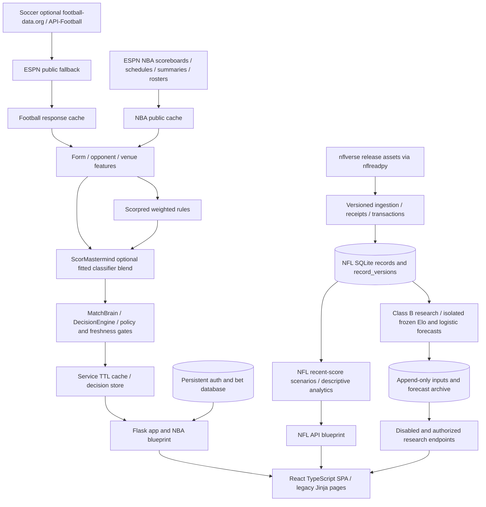

# ScorPred system diagnostic

Audit date: October 20, 2026 Eastern; final operational observations extend into October 21 UTC. This is an audit, not a remediation release. Production algorithms, running workers, stored observations, frozen models, and the sealed NFL outcomes were not changed by this work.

ScorPred has a functioning application and substantial reusable infrastructure, but its current predictions do not have uniform evidence of reliability. NFL has the strongest provenance and validation controls, with an important future guard gap. Soccer has reproducible retrospective classifier performance but incomplete data lineage and an unvalidated runtime blend. NBA has useful results coverage and scoring validation, but current winner performance is unknown. The latest operational state is **degraded**, despite earlier successful checks.

## Evidence and scope

The audit indexed 161 Python modules and 93 route declarations, inspected the React application, schemas, collection and research code, existing reports, and public caches. The index is a navigation aid, not proof that every execution path was exercised. Static findings are distinguished from function probes, historical replay, and actual running-service observations. No account contents or credentials are exported.

Exports live in [the audit directory](../cache/diagnostics/2026-10-20_multisport/). The [feature inventory](../cache/diagnostics/2026-10-20_multisport/feature_inventory.csv) has 280 entries with source, calculation, required inputs, missingness denominator, freshness, availability evidence, actual use, and limitations. Full model and data findings are in [validation](SCORPRED_MODEL_VALIDATION_AUDIT.md), [data quality](SCORPRED_DATA_QUALITY_AUDIT.md), [NFL](NFL_DATA_DIAGNOSIS.md), [NBA](NBA_DATA_DIAGNOSIS.md), and [soccer](SOCCER_DATA_DIAGNOSIS.md). Implementation priorities are in the [roadmap](SCORPRED_REMEDIATION_ROADMAP.md).

Evidence terminology:

| Class | Meaning |
|---|---|
| Observed / A | Received before kickoff with an actual receipt and bound input identity; a current observation does not prove historical publication time |
| Reconstructed / B | Prior-game chronology enforced, but historical source availability/revisions assumed |
| Unavailable / U | Required field or availability proof missing; no predictive claim supported |

## Architecture and data flow



`app.py` is the large central Flask application; `nba_routes.py` and `nfl_routes.py` provide sport workflows. `services` contains source adapters, caches, lifecycle checks, cards, scoring, and NFL research. React 19 / TypeScript / Vite 8 provides home, soccer, NBA, NFL, and Insights views, date navigation and kickoff expiry. Legacy server-rendered workflows coexist. Browser tests verify loaded cards disappear at kickoff and source expiry, and disabled NFL research sends no forecast requests.

NFL uses a roughly 3.10 GB SQLite store with five migrations, latest records, versioned observations, refresh attempts and receipts, plus frozen model/study/input/batch/forecast/event tables and immutability triggers. Other sports primarily use response JSON and CSV/model artifacts. `persistent/auth.db` contains user, bet, and submission tables; only schema/count/integrity metadata was inspected. Backup/verification NFL databases also exist; these are not additional live writers.

## Prediction workflows

Soccer forms and rules feed a three-class calibrated classifier blend, additional agreement and data-quality adjustments, and BET/LEAN/SKIP decisions. Classifier probabilities, blended probabilities, transformed confidence, edge, trust, and decision categories are different quantities. Only the classifier has a matching current retrospective replay. NBA normally uses weighted rules because its optional fitted winner classifier is absent. NFL production cards describe recent scoring scenarios; they are separate from frozen research probabilities and trained score projections.

Score models predict goals/points and uncertainty intervals, not winner probability. Player props use separate sample/threshold pathways with material data-contract problems. No claim that a validated score MAE establishes winner accuracy is justified.

## Ownership, refresh and operation

The app listener was observed at `127.0.0.1:5001`, PID 25016. The NFL Scheduled Task was Running with IgnoreNew singleton policy, launcher 23084 and collector PID 7812. No duplicate collector was observed. This is a point observation, not an uptime guarantee. The worker reports v2, schedule interval 240 seconds, PBP interval 21,600 seconds, and legacy full-feature snapshots about every 20 minutes. Research output flags remain disabled and production inactive; collection itself is running.

App APScheduler jobs declare soccer/NBA refresh every 25 minutes, model refresh hourly, and staleness checks every ten minutes, with coalescing and one instance per job. Gunicorn configuration uses one worker and four threads with worker lifecycle initialization. Configuration was reviewed; this audit did not restart or independently exercise crash recovery or simulate rate limits.

At **2026-10-20 17:41 UTC**, `/api/health` returned 200/ok. At **2026-10-21 02:56 UTC**, it returned **503/degraded**: last NBA success was 18:12:04 UTC (524 minutes earlier), soccer and model refresh last succeeded at 17:56:43 UTC (539 minutes). The NFL worker separately reported PBP ConnectionError/backoff; schedules succeeded at 02:54:55 UTC, forecast checks succeeded and no games were due. A bounded PBP HEAD request at 02:56:39 UTC returned 200, so a persistent unavailable upstream feed is not established. Collector log evidence includes a GitHub DNS NameResolutionError on a schedule attempt. The scope and duration of network failures remain unknown; retained data is not proof of a successful current refresh.

NFL receipts retain failed attempts and true receive times; no null observation timestamp was found in the metadata scan. Auxiliary NFL feeds mostly remain at October 18 observations. NBA/soccer caches do not provide equivalent immutable historical receipt ledgers. Monitor state is process memory; never-successful pipelines and mismatched monitor/cache freshness thresholds deserve explicit acceptance tests. Unknown freshness metadata is accepted by a compatibility path, whereas explicit unknown state and postkickoff requests are rejected in pure probes.

## Snapshot changes and preservation

A 130-file hash baseline was captured October 20 at 17:26:52 UTC. The final comparison found **128 unchanged and two changed files**, `app.py` and `scormastermind.py`, last modified at 18:20:20 UTC outside the audit edits. Current disk code adds separate ten-match ML contexts and target fixture dates; the original snapshot's soccer mismatch is therefore **corrected on disk, awaiting matched runtime validation**. The audit did not make or revert these changes. A long-lived app PID does not prove which version is loaded. Original sensitivity results remain labeled as the original defect's impact, not current performance.

All **83 prior NFL preservation-baseline files** remain unchanged, including frozen research artifacts. Current collection continues to append legitimately; a live database byte hash is not a preservation test. SQLite quick_check returned ok and foreign_key_check returned no violations. The audit used read-only connections and SQL projection/redaction; no sealed outcome was decoded. The full old observation-content digest was not recomputed in this audit.

## Reproduction

Run from the repository in PowerShell using the existing virtual environment. These commands write only diagnostic outputs; provider requests use public endpoints and NFL metadata HEAD requests. Live counts and freshness will change. To retain this snapshot, copy the audit directory first or pass another `--output` to helpers that support it.

```powershell
& .\.venv\Scripts\python.exe -m scripts.audit_scorp --section inventory
& .\.venv\Scripts\python.exe -m scripts.audit_scorp --section csv
& .\.venv\Scripts\python.exe -m scripts.audit_scorp --section caches
& .\.venv\Scripts\python.exe -m scripts.audit_scorp --section nfl
& .\.venv\Scripts\python.exe -m scripts.audit_scorp --section tracking
& .\.venv\Scripts\python.exe -m scripts.audit_scorp_models --section all
& .\.venv\Scripts\python.exe -m scripts.audit_scorp_features
& .\.venv\Scripts\python.exe -m scripts.audit_scorp_providers --local-url http://127.0.0.1:5001/api/health
& .\.venv\Scripts\python.exe -m scripts.audit_scorp_integrity
& .\.venv\Scripts\python.exe -m scripts.audit_scorp_report
& .\.venv\Scripts\python.exe scripts/verify_nfl_forecast_exports.py --study-sha256 fd4526c5da021c30c28538dcdb67faadc18f581d7ac451a2d56f1f6589534cb7
& .\.venv\Scripts\python.exe -m pytest -q
& .\.venv\Scripts\python.exe -m ruff check scripts/audit_scorp*.py
$auditNodeRoot = Join-Path (Get-Location) '.tmp\review\node-v22.23.3-win-x64'
$env:Path = $auditNodeRoot + ';' + $env:Path
& "$auditNodeRoot\npm.cmd" --prefix frontend run build
$env:PLAYWRIGHT_CHANNEL = 'msedge'
& "$auditNodeRoot\npm.cmd" --prefix frontend run test:e2e
```

`audit_scorp_integrity` reproduces the full read-only metadata scan and SQLite checks; `--skip-integrity` makes only the later metadata/health/preservation recheck. The initial integrity export and subsequent recheck intentionally have different observation times. Worker ownership can be checked without disclosing process command lines or account identity:

```powershell
Get-CimInstance Win32_Process | Where-Object { $_.ProcessId -in 25016,23084,7812 } | Select-Object ProcessId,ParentProcessId,CreationDate
Get-ScheduledTask -TaskName 'ScorPred NFL Collector' | Select-Object TaskName,State,@{Name='MultipleInstances';Expression={$_.Settings.MultipleInstances}}
Get-ScheduledTaskInfo -TaskName 'ScorPred NFL Collector' | Select-Object LastRunTime,LastTaskResult
Get-NetTCPConnection -State Listen -LocalPort 5001 | Select-Object LocalAddress,LocalPort,OwningProcess
Get-Content cache/nflverse/collector/status.json
Get-Content cache/nflverse/collector/collector.log -Tail 30
```

Do not run collection, training, dataset-preparation or sealed-evaluation commands to reproduce this audit. In particular the legacy `prepare_dataset.py` performs writes at import/execution.

## Verification baseline

The original backend snapshot passed 692 tests in 486.52 seconds. After the two outside-audit source changes, the current-source rerun passed **693 tests in 111.34 seconds**, including the NFL, NBA and soccer regression suites. TypeScript/Vite production build passed (1,746 modules); all **25 Playwright browser tests passed** in Microsoft Edge. Browser tests use mocked providers and therefore do not establish live provider uptime. Audit helper Ruff checks passed. Logs are retained in the audit directory. No test result supplies missing prospective model evidence.
